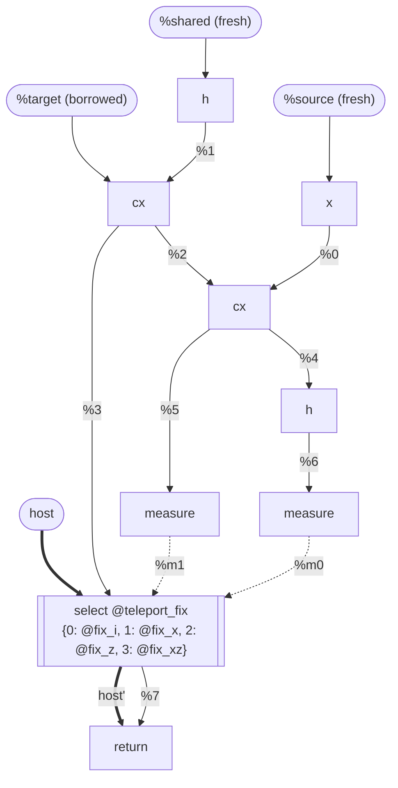
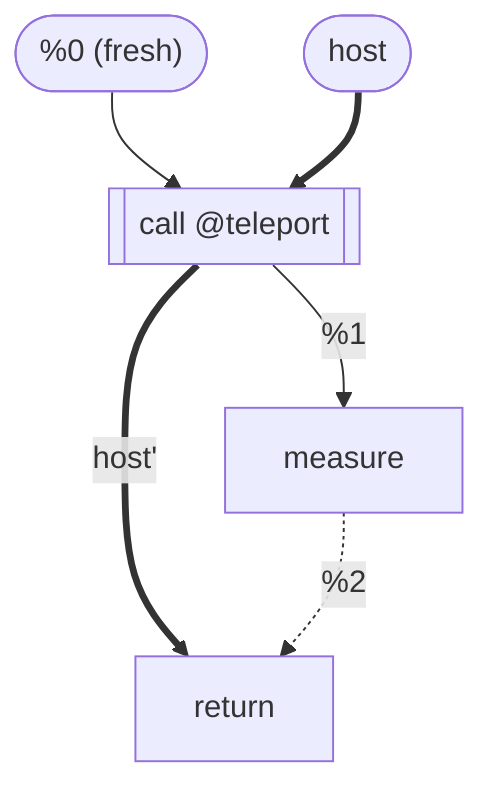
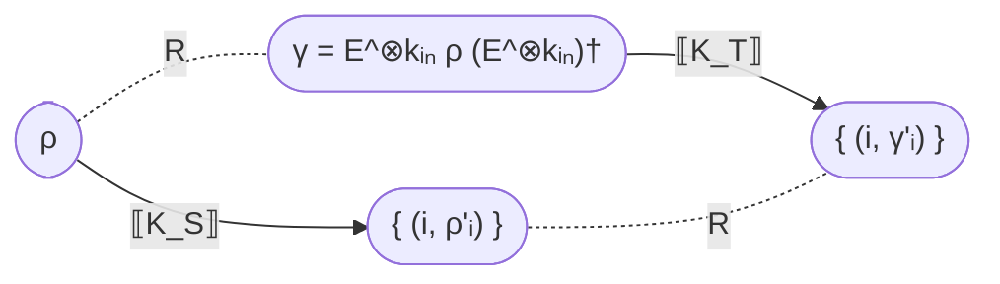

# Verifying qstack compiler passes

## 1. Goal and scope

qstack does not trust its compiler passes. Quantum programs are hard enough to validate that the compiler cannot be taken on faith, so every run of a pass produces a **witness**: a record of the transformation it performed. An independent verifier checks the source module, the target module, and the witness together; in the literature this is witness-carrying translation validation. Trust lives in the verifier, never in a pass. The executable language is the kernel-only IR specified in [`DESIGN.md`](DESIGN.md).

The goal is **semantic preservation**: for every fixed callback registry and initial host state for each callback source, the target (compiled) `@main` must behave like the source `@main`, read through the representation relation induced by the pass's declared encoding isometry. Throughout this document, **source** and **target** without qualification mean the pass input and its compiled output; a **callback source** is the namespace and host-state domain described in Section 2.3. The goal is not equality of IR: a pass may change representations, introduce internal measurements, widen target resources, and rewrite every unitary. The relation defines which externally visible behavior must survive.

Section 2 gives the semantic model, Section 3 the pass contract, Section 4 the checks, Section 5 what is deliberately deferred, and Section 6 the known limitations of the design.

### 1.1 Principles

- **P1. One semantic obligation.** Optimizations, QEC encodings, and dialect lowerings are all the same thing: preservation of the kernel's behavior modulo a representation relation.
- **P2. The pass is untrusted but cooperative.** A pass reports what it did, and everything it reports is checked before it is used. A false witness is refuted; one the verifier cannot check yields UNSUPPORTED. A witness affects what can be verified, never what counts as correct.
- **P3. Existing callbacks are interfaces.** A pass preserves every callback invocation in the source module, including its callback source and its order and multiplicity on that source's host wire, and never reasons about a callback's host implementation.
- **P4. New callback behavior is an obligation.** When a pass introduces a decoder or selector, the verifier derives the classical behavior it must have and reports it for a classical verifier to check.
- **P5. Graphs are matched; rules are checked.** Every claim applies a rule at one place in a kernel. qstack's linear dataflow lets it check that a kernel's claims form a graph that expands into both the source and the target kernel; the encoding relates the source and target wires at each claim's boundary. Separately, rule verifiers check that each rule holds; they need only its two small patterns, not a whole kernel with opaque callbacks. These local results compose to `@main`. A missing claim is REFUTED; a complete set of claims whose rules cannot be checked is UNSUPPORTED.
- **P6. Failures are attributable.** A refutation names the rule, claim, kernel, outcome, or callback interface that failed.

### 1.2 Noiseless boundary

This document verifies noiseless semantics only. It claims no fault tolerance, noise resilience, threshold, or correct behavior under a noisy syndrome-extraction circuit.

An error tag on an introduced select case has a deliberately limited meaning: the case claims to correct a named error at a stated point. The tag is specified here and in `DESIGN.md` but not yet implemented; today `qstack.select` carries no such attribute. A later noisy design may add error distributions, reachability under faults, and fault-tolerance claims; none are part of the present correctness statement.

## 2. Semantic model

### 2.1 A program is a collection of named kernels

A program is a module containing a finite collection of named kernels and callback declarations. One kernel, `qstack.kernel @main`, is the program's distinguished entry point.

`qstack.call` and `qstack.select` refer to other named kernels. Every invocation target is named in the symbol table; there are no function values or indirect calls, so every kernel reachable from `@main` is statically known.

Semantically, a kernel maps an input quantum state to one output quantum state for each possible returned bitstring. If `K` returns `m` bits, write:

```
⟦K⟧(ρ) = { (b, ρ_b) | b ∈ {0,1}^m }
```

Here `ρ` is the state of the kernel's input qubits and `ρ_b` is the subnormalized state of its returned qubits for outcome `b`. The trace of `ρ_b` is the probability that the kernel returns `b`. Different returned bitstrings may correspond to different quantum states; this correlation is part of the kernel's meaning. A map of this kind is commonly called a **quantum instrument**.

Fresh qubits allocated by the kernel begin in `|0⟩`. Only measurement results returned by the kernel appear in `b`; measurements consumed inside the kernel still affect the probabilities and output states but are not themselves observable results.

The instrument of a kernel is determined by its fresh-qubit allocation and by the operations in its body, including unitaries, measurements, decodes, calls, and selects. A `qstack.call` incorporates the instrument of its callee, while a `qstack.select` incorporates the instrument of the selected case kernel. The instrument denoted by `@main` is the meaning of the program. Because `@main` returns no qubits, its output quantum state belongs to the one-dimensional Hilbert space of zero qubits. For each returned bitstring `b`, the corresponding subnormalized state is the `1 × 1` matrix `[p_b]`, whose trace is the probability `p_b`. Thus the instrument of `@main` is a probability distribution over its returned bitstrings.

### 2.2 A kernel is a dataflow graph

Each kernel body forms a separate dataflow graph. The program is therefore a collection of kernel graphs. Verification compares each source kernel graph with its corresponding target kernel graph independently.

This graph view is not a new representation: linearity gives every qubit and bit value exactly one producer and one consumer, so the graph is already present in the kernel body, written down in sequence form.

The operations are the nodes; the SSA values are the wires. The sources are the borrowed inputs and the fresh `|0⟩` qubits; the sink is `qstack.return`. A `qstack.measure` is an interior node where a qubit wire ends and a bit wire begins. A `qstack.call` is a single opaque node; the callee's internals are not part of the caller's graph. A `qstack.select` references its case kernels, each a graph of its own.

Two kernel bodies are the same kernel when their graphs match: same nodes, symbols, attributes, and wiring. In particular, the order of two operations connected by no wire is not part of the kernel graph. This is safe in the noiseless model, where operations on disjoint qubits commute: emitting them in either order produces the same graph. Order matters only where a wire carries it, and one more wire is needed for the order that matters to callbacks.

This graph structure divides validation into two checks:

1. **Graph agreement, checked by qstack.** A pass records a list of claims for each kernel. Each claim applies a **rule**, a pair of small source and target patterns, at one place in the kernel (Section 3.2). The claims form a **claim graph**: each claim is a node with its rule's inputs and outputs, and the edges are the claims' bindings. qstack checks that the claim graph is linear, acyclic, and well typed; that expanding it with every rule's source pattern gives the source kernel graph; and that expanding it with every rule's target pattern gives the target kernel graph. On the target side, each qubit edge of the claim graph stands for a bundle of target qubit edges, as the encoding dictates, while bit edges stand for single edges. The claim graph also carries the existing callback-source host wires, so their order cannot change.
2. **Local semantics, checked by rule verifiers.** Check that each rule holds: that its target pattern implements its source pattern through the encoding. A rule is checked once, however many claims name it, using only its two patterns, gate semantics, and the encoding; the verifier need not parse the kernel or its claim graph.

The checks meet at the claim boundaries: graph agreement alone does not establish that a replacement computes the right result, while a valid rule alone does not establish that the pass applied it at the claimed places.

For example, the three-qubit repetition encoding pairs one source qubit edge with a bundle of three target qubit edges. A claim of the rule X3, whose source pattern is one `x` and whose target pattern applies `x` to each qubit of a bundle, is one node with one input and one output edge in the claim graph. An allocation rule starts the bundle for a fresh source qubit; a measurement rule ends it and restores one result bit through a decoder. Their checks are those of Sections 3.2 and 4.3. Thus widening the representation changes what each edge stands for in the target, while the claim graph still records the same flow of source computation. New callback sources and their obligations are handled separately under Sections 3.3 and 4.3.

### 2.3 Callback sources and host wires

Every selector and decoder belongs to a **callback source**, which identifies both a namespace and a host-state domain. An unqualified symbol denotes the empty source used by callbacks in the original program. A compiler-created declaration has the form `family.layer:name`; its `family.layer` prefix is the source. The positive `layer` is the one-based position of the introducing pass in the module's complete `qstack.pass_history`, so it identifies one exact transformation occurrence even when different pass families are composed. For example, `@rep3.1:decode` has source `rep3.1`, but resolves to the shared implementation `rep3:decode`. A later Rep3 pass uses its own global history position. Layers share the implementation, not its state; when needed, source-local state is passed separately.

Callbacks with the same source may share deterministic state, while callbacks with different sources cannot observe one another's state. Their implementations remain opaque to the compiler. Each source is represented in the kernel graph by one implicit **host wire**. A `decode` or `select` threads its source's wire, and a call threads every wire used transitively by its callee. The sequence on a wire records the order of callbacks that may share state; callbacks on different wires need no additional ordering unless connected by ordinary dataflow.

A pass preserves each existing callback's source, qualified name, interface, bit operands, reachability, multiplicity, and position on its host wire. Because the same deterministic implementation receives the same bits in the same source-local state, it produces the same result and state transition. A callback introduced by a pass instead uses a fresh source and carries the classical obligations of Sections 3.3 and 4.3. That source is retained by later passes, so the new host-state domain remains separate from earlier ones.

**Example: teleportation.** The module below teleports the state of a fresh qubit onto a borrowed one: `@teleport` prepares the state to send, entangles, measures both of its fresh qubits, and asks the host which Pauli fix to apply. It parses and verifies as written.

```mlir
builtin.module {
  qstack.selector @teleport_fix arity 2
  qstack.kernel @fix_i <[!qstack.qubit], [!qstack.qubit]> allocates 0 {
  ^bb0(%0: !qstack.qubit):
    qstack.return %0 : !qstack.qubit
  }
  qstack.kernel @fix_x <[!qstack.qubit], [!qstack.qubit]> allocates 0 {
  ^bb0(%0: !qstack.qubit):
    %1 = cliffords.x %0
    qstack.return %1 : !qstack.qubit
  }
  qstack.kernel @fix_z <[!qstack.qubit], [!qstack.qubit]> allocates 0 {
  ^bb0(%0: !qstack.qubit):
    %1 = cliffords.z %0
    qstack.return %1 : !qstack.qubit
  }
  qstack.kernel @fix_xz <[!qstack.qubit], [!qstack.qubit]> allocates 0 {
  ^bb0(%0: !qstack.qubit):
    %1 = cliffords.x %0
    %2 = cliffords.z %1
    qstack.return %2 : !qstack.qubit
  }
  qstack.kernel @teleport <[!qstack.qubit], [!qstack.qubit]> allocates 2 {
  ^bb0(%shared: !qstack.qubit, %source: !qstack.qubit, %target: !qstack.qubit):
    %0 = cliffords.x %source
    %1 = cliffords.h %shared
    %2, %3 = cliffords.cx %1, %target
    %4, %5 = cliffords.cx %0, %2
    %6 = cliffords.h %4
    %m0 = qstack.measure %6
    %m1 = qstack.measure %5
    %7 = qstack.select @teleport_fix(%m0, %m1) [%3] {"0" = @fix_i, "1" = @fix_x, "2" = @fix_z, "3" = @fix_xz} : (!qstack.qubit) -> !qstack.qubit
    qstack.return %7 : !qstack.qubit
  }
  qstack.kernel @main <[], [!qstack.bit]> allocates 1 {
  ^bb0(%0: !qstack.qubit):
    %1 = qstack.call @teleport(%0) : (!qstack.qubit) -> !qstack.qubit
    %2 = qstack.measure %1
    qstack.return %2 : !qstack.bit
  }
}
```

The graph reading of `@teleport`, with qubit wires solid, bit wires dotted, the empty-source host wire bold, and host nodes drawn with a double border:



And the graph of `@main`, where the host node is the call, because its callee reaches `@teleport_fix`:



The graphs make the model concrete:

- The sources of `@teleport` are the borrowed `%target`, the two fresh qubits, and the incoming host state; the sink is the return, which the host wire also leaves through.
- `x` and `h` share no wire, and neither do the two measures: their relative order is not part of the program, and a pass may emit either first.
- Each measure ends a qubit wire and starts a bit wire. Both bit wires flow into the select, so no measurement outcome leaves the kernel.
- The select is the kernel's only host node. Its case kernels are separate graphs referenced by label: `@fix_x` is a single `x` node between its borrowed input and its return.
- In `@main`, the call is an opaque node on the host wire while the final measure stays off it. A pass that moved or dropped the select would change the host wire's shape and be refuted; a pass that emitted the two measures in the other order would produce the same `@teleport` graph, which is no change at all.

### 2.4 Host interfaces and kernel boundaries

A program exposes behavior to the host in two places: when it delivers bits to a callback, and when `@main` returns its bit results. These are the program's **host interfaces**. At these points, target bits must equal the corresponding source bits. Existing callbacks must also preserve the symbol, declaration, bit arity and operand order, case map, order, multiplicity, and reachability required by Section 2.3. `@main` never returns qubits.

A call from one kernel to another is not a host interface. Its arguments and results remain internal to the qstack program, and the compiler may change their representation. For example, a source call that passes one qubit may become a target call that passes an encoded block of qubits. No host code observes that change.

Kernel boundaries are nevertheless **verification boundaries**. Because each source-target kernel pair is verified independently, their signatures must correspond through the representation relation: each source qubit corresponds to a bundle of target qubits related by the pass's encoding, while their bits are equal under `R_bit`. This allows the verifier to use a callee's result when checking its caller without inspecting the callee's graph.

A pass may therefore change internal measurement, encoding, and decoding plumbing, provided that:

- each kernel pair satisfies the representation relation at its signature;
- every existing callback receives the corresponding source bits; and
- `@main` returns the same externally visible bits.

### 2.5 The correctness statement

A pass declares one encoding isometry `E`, from the states of one qubit to the states of `n` qubits. For the three-qubit repetition code, `E|0⟩ = |000⟩` and `E|1⟩ = |111⟩`. A pass that preserves representation declares `E = I`, with `n = 1`. Each source qubit is represented by a bundle of `n` target qubits, in a fixed order.

Together with equality on bits, this encoding induces the **representation relation** used below. For a state `ρ_S` of `k` source qubits and the state `ρ_T` of their `k` bundles, the quantum relation induced by `E` is:

```
R_E(ρ_S, ρ_T)  iff  ρ_T = E^⊗k ρ_S (E^⊗k)†.
```

Thus the target state must lie in the image of `E^⊗k`. Bits use the same relation in every pass:

```
R_bit(b_S, b_T)  iff  b_S = b_T.
```

Bits use equality because existing callbacks are opaque: changing a bit could change callback behavior. Thus every pre-existing callback must receive exactly the source bit tuple, and independent kernel checks require the same equality at every kernel boundary. Internal target measurement bits must be decoded back to this equality before crossing one.

At a kernel boundary with `k` qubits, the induced encoding is `E^⊗k`. This is one pass-level `E` applied once per source qubit, not one separately declared isometry per wire or claim. It applies to the complete joint state, preserving correlations and entanglement.

#### Kernel behavior by outcome

A kernel that receives state `ρ` produces the outcome-indexed family described in Section 2.1. For each possible tuple `i` of returned bits, the family contains the corresponding subnormalized state `ρ'_i` of the returned qubits:

```
⟦K⟧ : ρ ↦ { (i, ρ'_i) }
```

The trace of `ρ'_i` is the probability of outcome `i`, and the traces of all outcome components sum to one. Measurement results consumed inside the kernel by `decode` or `select` do not appear in `i`; their effects are already included in the outcome components.

#### When two kernels are related

Run the source kernel `K_S` on `ρ`. If its input contains `k_in` qubits, run the target kernel `K_T` on the related input `γ = E^⊗k_in ρ (E^⊗k_in)†`:



Both kernels must return bits with the same arity and meaning, so their outcome-indexed families use the same index `i`. The target kernel's internal decoders ensure that `i` contains source-equivalent bits, not raw target measurement results.

The kernels are related if, for every input `ρ` and every returned-bit outcome `i`:

```
γ'_i  =  E^⊗k_out ρ'_i (E^⊗k_out)†
```

Here `k_out` is the number of returned qubits. In words: for each classical outcome, the target kernel's remaining quantum state must represent the source state through the pass's encoding. Because an isometry preserves trace, the two kernels also assign the same probability to that outcome.

This one equation preserves all externally visible behavior:

- returned bits have the same values and probabilities;
- the quantum state associated with each returned-bit outcome is preserved through the encoding;
- correlations among returned bits and qubits are preserved;
- callers, case maps, callbacks, and `@main` can use target results without translation; and
- pre-existing callbacks receive identical bits in the same order on each callback source's host wire, so they produce the same results and host-state evolution under Section 2.3.

The statement also covers consumed borrowed qubits and escaping fresh qubits because each `ρ'_i` contains exactly the qubit results declared by the kernel. Borrowed bits select which outcome-indexed family applies, so the equation must hold for every pair of related borrowed-bit assignments.

#### Encoded measurement and decoder obligations

The bit relation is equality, including at a measurement boundary. When a pass replaces source measurement with measurements of the represented target tuple, the target's raw measurement bits are internal. A fresh opaque decoder must turn them into the source-level bit or bit tuple that would have left the source measurement. The verifier derives this finite classical requirement from the measurement rule and reports it as an obligation; a classical verifier checks the registered decoder implementation. The decoder's required map is therefore not part of the representation relation or its declaration. For the three-qubit repetition encoding, the derived requirement is majority vote.

#### What the verifier checks

The commuting square above defines correctness; it is not the algorithm used to check a pass. The verifier cannot compute `⟦K_S⟧` or `⟦K_T⟧` directly because kernel behavior depends on opaque callback implementations, and correctness must hold for every callback registry.

Instead, qstack checks that each kernel's claims form a claim graph that expands into both kernel graphs, including every existing host wire (Sections 2.2 and 4.2). Rule verifiers check that every rule the claims name holds (Section 4.1). Together with the derived classical obligations of Section 4.3, those facts compose into the square (Section 4.4).

## 3. The pass contract

### 3.1 The witness

A pass emits, alongside its target module, a witness containing:

1. its **encoding isometry**: the pass's single `E`, including `E = I` for a same-representation pass;
2. the **rules** its claims name (Section 3.2); and
3. the **claims** of each kernel: each claim names one rule and binds the rule's inputs and outputs to the edges that enter and leave the place where it was applied.

Error tags are not part of the witness: they are annotations on the cases of an introduced `select` in the target module (Section 3.3).

The witness is bookkeeping a rewrite driver records as it applies each rule, so pass authors do not write witnesses by hand. This sets the scope deliberately: qstack verifies passes built on its own pass framework, cooperative but untrusted, and does not try to reconstruct what an uninstrumented third-party pass did from the source and target modules alone.

A pass applies everything in one shot through its induced relation: an encoding pass applies its gate, allocation, and measurement rules together, and no intermediate module ever exists to be valid or invalid. Verification sees the source module, the target module, and the witness.

A pass transforms the program kernel by kernel. The unit of compilation and verification is a pair of source and target kernel graphs, not one whole-program graph. The verifier checks each pair independently: a call remains an opaque node in the caller's graph, while its callee pair is verified separately. Section 4.4 then composes the per-kernel results into the end-to-end claim about `@main`.

This independence restricts a call to exactly two replacements: inline it, or keep the call, with an identity rule or, under a non-identity encoding, a widening rule for the callee's widened signature. Any other rewrite of a call would tie the caller's check to the callee's internals.

### 3.2 Rules and claims

A **rule** is a pair of small graphs with the same numbered inputs and outputs, its **source pattern** and its **target pattern**. A rule **holds** if its target pattern implements its source pattern through `E`. A **claim** applies a rule at one place in a kernel: it names the rule and binds the rule's inputs and outputs to the edges that enter and leave that place. The pieces of the source and target kernels it accounts for are the rule's two patterns, placed at those edges.

Since every claim that names a rule uses that rule's patterns, checking the rule once covers all of them: a rule applied at a thousand places is one rule to check and a thousand claims. A pass therefore uses one rule for each distinct rewrite it performs; two rewrites that differ in either pattern, even in how their gates are wired, are different rules. Rules are concrete: gate angles and other parameters are actual attributes from the site, not symbolic variables. Rules are written as pairs of small kernels, which reuses the parser, linearity checks, and signature syntax already used for program kernels; these kernels are proof artifacts, not kernels invoked by the program.

Every claim names a rule, including the claims for operations the pass leaves untouched, and there is no default claim. The claims of a kernel form its claim graph, which must expand into both kernels (Section 4.2); because the expansions give exactly the two kernels, every node of each is accounted for by exactly one claim. A node no claim accounts for makes the expansion fail, and the witness is REFUTED. Under a non-identity encoding, each port of a target pattern that corresponds to a source qubit is a bundle of `n` ports, in the fixed order of the encoding.

The rule kinds below are a closed but extensible vocabulary: a new kind, classical rules included, needs a defined check before any pass may use it (Section 5). Not every verifier backend can check every rule; Section 4.1 describes how backends are tried.

**Identity.** Both patterns are the same single operation. An identity rule holds trivially and is checked syntactically. It claims every operation the pass leaves untouched, including every pre-existing `decode` and `select`. Under a non-identity encoding, only operations without qubit ports, such as `decode`, keep identity rules.

**Widening.** Under a non-identity encoding, an operation the pass leaves alone still changes if it has qubit ports, because those ports widen into bundles. A widening rule's target pattern is its source pattern with every qubit port widened into a bundle. It claims a `call`, `select`, or `return` with qubit ports, and is checked syntactically. A widened `call` keeps its callee, and a widened `select` keeps its callback source, symbol, arity, bit operand order, and case map; what the callee or each case kernel does is verified by its own kernel pair (Section 4.4).

**Inline.** The source pattern is a single call; the target pattern is the callee's body as it is in the source module, even if the pass also rewrites the callee itself. The callee's parameters become the pattern's inputs, the operands of its `return` become the pattern's outputs, and its fresh qubits become fresh qubits of the caller. Each inlined callee therefore has its own rule, checked by graph matching. Inlining is exact substitution, so any callee qualifies, including one that measures or invokes callbacks: the copied callback uses execute exactly when the call would have, keeping every host wire intact. A pass that wants to rewrite across a call boundary inlines first and rewrites the copy in a second pass; the module between the two passes is an ordinary valid program. Because the copy is verbatim, inlining under a non-identity encoding cannot typecheck (a source-representation copy cannot wire into target-representation surroundings), so inlining happens before the encoding pass or after it. A callee left unreachable may be dropped. Outlining, the inverse, has no rule kind (Section 3.4).

**Gate.** Both patterns contain only gates. Writing `g` for the unitary of a source pattern on `k` qubits and `G` for that of its target pattern, a gate rule holds if:

```
G E^⊗k = E^⊗k g
```

With `E = I`, this is ordinary unitary equality, and gate rules cover optimizations and dialect lowering: `S;S → Z`, `x → sx;sx`, or `H;H → ε`, whose empty target pattern connects its one input directly to its one output. Under the three-qubit repetition encoding, the rule that implements one source `x` by an `x` on each qubit of a bundle is also a gate rule.

**Allocation.** Under a non-identity encoding, a fresh source qubit starts in `|0⟩`, so its bundle must start in `E|0⟩`. An allocation rule pairs one fresh qubit with `n` fresh qubits followed by a circuit that prepares `E|0⟩` from `|0…0⟩`. For the repetition code this circuit is empty. Fresh qubits are kernel entry values rather than operations, so the claim graph gives each one a node to claim.

**Measurement.** Under a non-identity encoding, measuring a source qubit becomes measuring its whole bundle and passing the `n` raw bits to one fresh `decode`, which returns one bit:

```
source:  measure one qubit ──────────────────────────────→ one bit
target:  measure the bundle → fresh decode ──────────────→ one bit
```

The rule holds if that bit is always the one the source measurement would have produced. The raw target bits remain inside the target pattern. The fresh `qstack.decoder` callback remains opaque; the verifier derives and reports the finite behavior it must have for classical discharge under Section 4.3. This is the only rule whose target pattern hands out a newly created bit, which keeps `R_bit` equal at every kernel and host boundary.

**Fixup.** Some rewrites implement a gate with a measurement followed by a correction. A fixup rule's source pattern contains only gates. Its target pattern may allocate qubits, apply gates, measure, and pass the outcomes to one `select` whose selector is fresh; the cases of that `select` are gate-only kernels the pass adds to the target module. No bit leaves the target pattern.

T-injection is a fixup rule. Its source pattern is a single `t`; its target pattern prepares an ancilla in `T|+⟩`, entangles it with the qubit, measures the ancilla, and lets a fresh selector choose the correction:

```text
source:  %r = t(%q)

target:  %a = h(%0)                       // %0 is a fresh ancilla
         %b = t(%a)
         %c, %d = cx(%q, %b)
         %m = measure(%d)
         %r = select @tfix(%m) [%c] {"0" = @id, "1" = @s}
```

A fixup rule pairs each possible outcome `m` of its measurements with one case. Fixing the outcome to `m` and replacing the `select` with the body of the case paired with `m` gives a circuit `G_m`, with the measured qubits projected onto `m`. The rule holds if, for every `m`:

```
G_m E^⊗k = c_m E^⊗k g
```

for some scalar `c_m`, where `|c_m|²` is the probability of `m`. Every outcome then leaves `g` applied through `E`, and an outcome with `G_m = 0` cannot occur and imposes nothing. For T-injection, outcome `0` leaves `T` applied and outcome `1` leaves `T†`, which `@s` corrects to `T`. The rule also requires the selector to return, for each outcome, the label of the case paired with it; the verifier derives that outcome-to-case map and reports it as the selector's classical obligation (Section 4.3). For T-injection, `@tfix` must map `0` to `"0"` and `1` to `"1"`.

A case that cannot be reached in the noiseless semantics, such as a QEC correction case, imposes nothing under this check. It carries an **error tag**, an annotation on the case that names the error the case claims to correct, and is checked by its correction identity (Section 4.3). Error tags are specified but not yet implemented.

**Gates, calls, and callbacks.** Apart from identity, widening, and inline rules, no pattern contains a call or a pre-existing callback. A call must be inlined before a rule can see the callee's operations, and C1 keeps existing callbacks out of every other rule.

For example, an encoded transformation of

```
allocate → X → measure → return
```

is covered by four claims: an allocation rule prepares the bundle, the gate rule X3 implements `X`, a measurement rule measures and decodes the bundle, and an identity rule preserves the `return`, which returns a bit. Under `E = I`, the same kernel is covered by identity rules wherever the pass leaves an operation alone, and allocation needs no preparation.

Two asymmetries keep these rules sound. A target pattern may introduce measurements, because measurements carry no hidden host state, but it may not introduce a use of a pre-existing callback, which may be stateful. And except for a measurement rule, no target pattern lets a bit it creates leave the pattern.

### 3.3 Callback conditions

Conditions on the witness; Section 4 rejects one that violates them.

- **C1. Existing callbacks are untouchable.** Every pre-existing `decode` and `select` node is claimed by an identity or widening rule, or copied by an inline rule, and appears in no other rule. Its declaration symbol, and therefore its callback source, is preserved. Case kernel bodies may be transformed, but the callback-visible case map does not change, and the callback is not reverified.
- **C2. A new decode appears only in a measurement rule.** Its output stands for the source measurement's bit. A decode is never introduced to pre-process bits for an introduced selector: a selector is an arbitrary function of its bits, so that computation belongs inside it, keeping each introduced callback's obligation standalone. The declaration and every new use are fresh relative to the source module.
- **C3. A new select appears only in a fixup rule's target pattern.** Its selector declaration and use are fresh. A case reachable in the noiseless semantics is justified by the rule's per-outcome check; an unreachable case, as a QEC correction case is, carries an error tag annotation naming the error it claims to correct (a tag for an error at another point must state that point) and is checked by its correction identity. Once introduced, the selector and its cases are fixed: later passes preserve them under C1 like any other callback.
- **C4. Introduced bits are internal.** Bits created for a new decoder or selector must not reach a pre-existing callback or a `@main` result without an explicit relation restoring the source observable. A transformation may not add a new opaque classical interface.
- **C5. Introduced callback sources are fresh.** Every introduced callback declaration has a qualified symbol whose nonempty source prefix is absent from the source module. Callbacks introduced together may share a fresh source only when their stateful behavior is covered by one joint classical obligation; otherwise their sources are distinct. Runtime state is partitioned by callback source, so a new source cannot perturb the state carried by an existing host wire.

### 3.4 Transformations outside the contract

A transformation that has a complete witness but whose rule kind or semantic obligation the verifier cannot check gets UNSUPPORTED rather than a refutation. Today that includes outlining a fragment into a new kernel (the inverse of inlining, with no rule kind yet) and any rewrite of a source region containing a measurement or pre-existing callback other than through the identity, widening, inline, and measurement rules above. Reordering two operations connected by no wire is not on this list, because it is not a transformation: the source and target modules have the same graph. Moving a pre-existing callback along its host wire or changing its callback source is a shape change and is refuted. The verifier never searches for unwitnessed correspondences: a node or rewrite absent from the claims makes the witness malformed and is REFUTED, even if the transformation happens to be correct.

**Example: Pauli-frame tracking.** An encoding pass may try to defer Pauli corrections into later measurement decoding instead of materializing them with `qstack.select`. The current relation cannot represent the tracked frame, so such a transformation is UNSUPPORTED; it requires the frame-enriched qubit relation deferred in Section 5. A later pass also cannot remove an already materialized correction select: doing so changes its host wire and is REFUTED.

## 4. How verification checks the witness

### 4.1 Checking rules

Each rule is checked once, on its own, however many claims name it. Rules are only as big as the rewrite, not the program, so these checks stay small even when the program is large or calls opaque callbacks. Different kinds of rules call for different checks:

- **Identity and widening rules** are checked syntactically: the target pattern must be the source pattern itself or, for a widening rule, the source pattern with every qubit port widened into a bundle.
- **Inline rules** are checked by graph matching: the target pattern must be the same graph as the callee in the source module.
- **Gate rules** are checked against `G E^⊗k = E^⊗k g`, using gate matrices supplied by the dialect definitions.
- **Allocation rules** are checked by confirming that the preparation circuit takes `|0…0⟩` to `E|0⟩`.
- **Measurement rules** are checked by deriving the decoder's requirement from `E` and reporting it as a classical obligation (Section 4.3).
- **Fixup rules** are checked one outcome at a time against `G_m E^⊗k = c_m E^⊗k g`. The same check derives the outcome-to-case map required of the fresh selector. Tagged unreachable correction cases are checked separately under Section 4.3.

Identity, widening, and inline checks are built in. For the circuit checks, the verifier tries the available backends in turn: dense matrices for small rules, stabilizer methods for Clifford rules, and external equivalence checkers for larger ones. A backend either verifies, refutes, or declines. The first definitive answer wins: a verification from any sound backend suffices, a refutation is final and refutes the pass no matter how many claims name the rule, and if every backend declines, the result is UNSUPPORTED, naming the rule. Some backends need the encoding in a specific form, such as one given by its stabilizer generators; that side data and the integration API are deferred (Section 5).

### 4.2 Checking the claims

For each source-target kernel pair, qstack builds the claim graph from the kernel's claims. Its sources are the sources of the source kernel: its parameters and the host source. Each claim is a node whose inputs and outputs are those of its rule, and the edges, which are the claims' bindings, run from a source or from an output of one claim to an input of another. **Expanding** the claim graph with the source patterns replaces each claim node with its rule's source pattern, attaching the pattern's inputs and outputs to the claim's edges; where a pattern connects an input directly to an output, as the target of `H;H → ε` does, the two edges become one. Expanding with the target patterns works the same way, except that under a non-identity encoding each qubit edge becomes a bundle, and the `j`-th edge of each bundle joins the `j`-th port of the next pattern. This graph check is independent of the rule checks in Section 4.1. It consists of:

1. **Well-formed claims.** Every claim names a known rule and binds every input and output of that rule.
2. **A valid claim graph.** The claim graph is linear, acyclic, and well typed. Acyclicity is what lets each claim's pattern stand alone as one action: no path leaves the piece a claim expands into and comes back into it.
3. **Expansion.** Expanding with the source patterns gives the same graph as the source kernel, and expanding with the target patterns gives the same graph as the target kernel. Since the expansions give exactly the two kernels, every node of each is accounted for by exactly one claim, and no remainder exists on either graph. Freshness (C2, C3, C5) is checked against the source module's callback sources and symbols.
4. **Host wires.** Because pre-existing callbacks appear only in identity, widening, and inline rules (C1), the host wire of every existing callback source passes through the same callbacks, in the same order and with the same inputs, in both kernels. Introduced callbacks appear only on fresh host wires inside the patterns that introduce them.

These checks are structural; Section 4.1 discharges the semantic obligations they identify. A witness that makes a false statement, such as a claim whose expansion does not match the kernel, or that is silent about any node, is REFUTED. The failure names the claim, rule, or node.

### 4.3 Derived classical obligations

An introduced callback's required behavior is derived from the quantum relation, never trusted (P4).

For a decoder introduced by a measurement rule, the verifier does not execute or inspect the implementation. It derives and reports a finite obligation: the callback source, qualified declaration symbol, and shared implementation key; the input layout; the reachable input tuples in the noiseless relation; the required output for each; and any explicitly unconstrained tuples. A classical verifier checks the registered decoder against it; until then, the quantum result is verified modulo the reported obligation.

For a selector introduced by a fixup rule, the verifier derives the outcome-to-case behavior required on every reachable outcome (Section 4.1) and checks each tagged unreachable case at its declared point. For an error `F` occurring after a replaced operation `U`, the correction case kernel `C_F` must satisfy:

```
C_F F U = U
```

Equivalently, `C_F F = I` on the image of the code space where `F` occurs; a tag naming an error at another point uses the correspondingly conjugated relation. From the measurement structure and the tags, the verifier then reports the finite syndrome-to-case behavior required of the selector, together with its callback source, qualified declaration symbol, and shared implementation key, for a classical verifier to check against the registered implementation.

When several callbacks share a fresh source such as `rep3.1`, their per-callback requirements form one joint classical obligation. That obligation follows their ordered invocations on the source's host wire and accounts for any state they share. Giving each callback a distinct source avoids this joint reasoning.

### 4.4 Composition

The end-to-end claim rests on these facts:

- **Local composition.** Claims compose along the claim graph, so an introduced decoder or selector is justified at the claim that introduces it rather than against an enclosing kernel.
- **Kernel calls.** If a callee pair is related, the corresponding target call preserves the caller's relation.
- **Kernel composition.** If a kernel's claims relate it to its target, every rule they name holds, and every existing host wire is preserved, the source and target kernels are related.
- **Root adequacy.** If every reachable kernel pair is related, all pre-existing callback uses and sources are preserved, and every added obligation is discharged, the source and target `@main` are related for the fixed registry and initial state of each callback source.

These rely on linearity and the host wires: together they leave no unaccounted wires, copies, discards, or unordered host interactions within a callback source.

### 4.5 Verdicts and obligation handoff

Quantum verification produces one of:

- **VERIFIED**: all quantum obligations discharged, no classical obligations generated;
- **VERIFIED MODULO CLASSICAL OBLIGATIONS**, with the finite decoder and/or selector contracts still to be checked;
- **REFUTED**, naming the failing rule, claim, kernel, outcome, relation, or callback interface; or
- **UNSUPPORTED**, when a rule exceeds every backend or the transformation lies outside what the witness can express.

The handoff to a classical verifier is part of the design boundary; its data format and integration APIs are not fixed here.

## 5. Deliberately deferred

This document does not yet choose:

- concrete rule-checking backends and the API that selects one per rule, including per-backend side data such as an encoding given by its stabilizer generators;
- the witness serialization: rule format, claim encoding, claim arguments;
- additional rule kinds beyond those of Section 3.2, including classical rules over the decode and select structure;
- the classical obligation data structure and pass-manager integration;
- an API through which a pass declares its encoding isometry or error tags;
- channel-valued rules: rules whose source pattern contains a measurement, or whose patterns denote an instrument rather than a single unitary, checked as channel equivalence; today every gate or fixup rule's source pattern is unitary, and a source measurement whose bit must survive is claimed by an identity or measurement rule;
- kernel summaries: a call to a transitively unitary, non-recursive kernel summarized by its unitary, letting the call appear in a gate rule's source pattern without inlining first;
- the frame-enriched qubit relation for encoding passes that track Pauli frames instead of materializing corrections;
- relational obligations for trace-changing rewrites, all of one shape: a subgraph of pre-existing callbacks is replaced by fresh ones, with the obligation that the two are equal as functions of the removed symbols and a statelessness requirement on each removed callback. Correction-select removal is the instance with quantum content (yielding `decoder(s, m) = m ⊕ flip(fix(s))` by conjugating each case's Pauli through the intervening Cliffords); fusing stacked decode chains and select towers is purely classical. Section 2.3 forbids all such trace changes today; or
- noisy and fault-tolerance verification.

Those are implementation-planning work after this document and `DESIGN.md` have been reviewed together.

## 6. Known limitations

These are downsides of the architecture itself, not missing features: each one is the price of a decision this document defends, and the first three can be softened while the last cannot.

- **Calls are optimization fences.** A rewrite spanning a call boundary, such as a gate at the end of a callee cancelling a gate after the call site, is invisible to every rule kind: patterns cannot see into an opaque call, and identity and widening rules keep the call as is. The workaround is staging: inline in one verified pass, rewrite the copy in the next. Kernel summaries (Section 5) will recover the transitively-unitary case without inlining.
- **Inlining is blunt and one-way.** It duplicates the callee's body per call site, there is no outlining claim to fold structure back, and a recursive kernel can never be fully inlined, so a recursive call boundary is a fence nothing removes.
- **No retargeting.** Identity and widening rules keep the callee symbol, so a pass cannot specialize a kernel for some call sites, merge duplicate kernels, or change a callee's signature. This is the deepest of the three call limitations, because it cannot be fixed with a better rule kind: every obligation in this design has the shape "this pass transformed this kernel correctly," while retargeting needs "these two kernels are equivalent," an equivalence between independently written kernels, which is exactly the whole-instrument comparison P5 refuses. The one cheap special case is retargeting to a syntactically identical kernel, which a future rule kind could check like an inline copy; the general case is out of reach by design.
- **No context-sensitive correctness.** Each kernel pair must satisfy the square for every input state, because callees are verified in isolation. A rewrite that is correct only for the states a caller actually supplies, for instance a callee that always receives `|0⟩`, is refuted or unsupported even when the whole program would be fine. Whole-program verifiers can accept such rewrites; this design trades them away for per-kernel cost and attribution, and no staging recovers them.

## 7. Related work and lineage

The design is witness-carrying translation validation: an untrusted transformation produces a target module and a witness that an independent checker validates, with unsupported cases reported explicitly. Relevant precedents include [Why3](https://www.why3.org/), [Alive2](https://github.com/AliveToolkit/alive2), [CompCert](https://compcert.org/), [VOQC](https://arxiv.org/abs/1912.02250), [CertiQ](https://arxiv.org/abs/1908.08963), [MQT QCEC](https://github.com/munich-quantum-toolkit/qcec), and [Stabilizer Circuit Verification](https://arxiv.org/abs/2309.08676).

qstack's distinctive requirement is to preserve an opaque, stateful host interface while deriving, rather than trusting, the finite classical contracts needed by newly introduced quantum/classical fragments.
